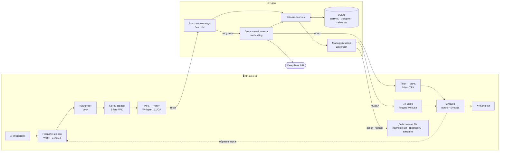

<div align="center">

# 🎙️ Lumo

### «Вальтер» — личный голосовой ИИ-ассистент в духе Джарвиса

Слышит своё имя, понимает русскую речь, думает с помощью LLM и **действует**:
управляет компьютером, включает музыку, ставит таймеры, помнит разговоры.
Всё, кроме «мозга», работает **локально и бесплатно**.


*A Jarvis-like voice assistant for Russian speech: local wake word, STT, TTS and echo
cancellation, DeepSeek tool calling, PC control and Yandex Music — on a near-zero budget.*

</div>

---

## ✨ Что умеет

<table>
<tr>
<td width="50%" valign="top">

**🗣️ Живой голосовой диалог**
- Просыпается на «Вальтер», отвечает естественным русским голосом
- Перебить можно **любой фразой** прямо посреди ответа
- Не слышит сам себя: подавление эха как в Zoom/Meet
- Частые команды (громкость, пауза, время) — **мгновенно и без ИИ**

</td>
<td width="50%" valign="top">

**🖥️ Управление компьютером**
- Открыть / закрыть приложение по названию
- Сайты и поиск в интернете
- Громкость, звук, медиа-клавиши для любого плеера
- Выключение с подтверждением, блокировка, скриншоты, окна

</td>
</tr>
<tr>
<td valign="top">

**🎵 Яндекс Музыка внутри ассистента**
- «Включи Кино», «Моя волна», «Мне нравится», лайки
- Играет сразу, пока трек ещё скачивается
- Сама затихает, когда Вальтер говорит или слушает
- Видна в медиапанели Windows, работают медиа-клавиши

</td>
<td valign="top">

**🧠 Память и время**
- Запоминает факты о вас: «запомни, что я люблю чай»
- Общая история для всех устройств
- Таймеры и напоминания, которые переживают перезапуск
- Как отвечать — решаете вы: молча, коротко или подробно

</td>
</tr>
</table>

## 🎬 Как это выглядит

```text
Готов. Скажите «Вальтер» и команду.

Вы: Вальтер, включи Кино
Вальтер: Включаю исполнителя КИНО. Играет КИНО — Группа крови.
♪ Играет: КИНО — Группа крови
Вы: Вальтер, громкость 30
✓ Громкость 30%.                                ← мгновенно, 0 токенов
Вы: Напомни завтра в девять позвонить маме
Вальтер: Напомню завтра в девять ноль-ноль.
Вы: Вальтер, выключи компьютер через час
Вальтер: Подтвердите: выключить компьютер через 60 мин. Выполнить?
Вы: Да
Вальтер: Компьютер выключится в 18:05.

🎤 ████████░░░░░░░░   -32 dB │ Жду «Вальтер» │ ♪ КИНО — Кукушка
```

## 🧩 Как устроено

**Ядро думает и помнит — клиенты слушают и говорят.** Ядро работает только с текстом, поэтому
любое устройство (ПК сейчас, телефон дальше) подключается одинаково и видит общую память.
А всё, что касается «железа», ядро поручает устройству, у которого есть нужная возможность.



## 🔧 Инженерные решения

Проект вырос из реальных проблем при живом тестировании голосом — вот самые интересные:

| Проблема | Решение |
|---|---|
| Ассистент слышит собственный голос из колонок | Свой аудиодвижок: всё, что уходит в колонки (голос **и** музыка), подаётся в **WebRTC AEC3** как образец и вычитается из микрофона — эхо гасится на ~30 dB |
| Ложные «перебивания» от остаточного эха | Ассистент не замолкает сразу: говорит тише, распознаёт фразу и проверяет уверенность Whisper и совпадение со своей речью — только потом останавливается |
| Каждая «громкость 10» стоила ~3,5 тыс. токенов и 2 секунды | **Быстрые команды**: фраза целиком сверяется с шаблонами и выполняется навыком напрямую — 0 токенов; для остального промпт перестроен под **кэш DeepSeek**: ~92 % входа из кэша |
| LLM «выполняла» действия на словах, копируя старые ответы | История хранит вызовы инструментов, а ядро ловит ответы о действиях без вызова навыка и заставляет модель сделать всё по-настоящему |
| Трек с серверов Яндекса качается больше минуты | **Потоковое воспроизведение**: aiohttp-чанки → потоковый декодер miniaudio → музыка стартует через пару секунд |
| Громкость через FxSound не менялась программно | Громкость меняется так же, как с тачпада, — виртуальными клавишами громкости |
| Опасные действия от лица пользователя | Подтверждение «да/нет» решает ядро, а не LLM — модель не может согласиться сама за себя |

## 🧰 Стек

| Задача | Технология | Где работает |
|---|---|---|
| Мозг | DeepSeek (OpenAI-совместимый API, tool calling) | облако |
| Слово-активатор | Vosk small-ru | CPU |
| Конец фразы, перебивание | Silero VAD | CPU |
| Речь → текст | faster-whisper `small`, int8 | GPU (CUDA) / CPU |
| Текст → речь | Silero TTS v4 | CPU |
| Подавление эха | WebRTC AEC3 (livekit) | CPU |
| Ядро | FastAPI + WebSocket, asyncio, SQLite | локально |
| Музыка | yandex-music, miniaudio, Windows SMTC | локально |
| Управление ПК | WinAPI (ctypes), Core Audio (pycaw), Get-StartApps | Windows |
| Качество | pytest (290 тестов), ruff, спецификации OpenSpec | — |

## 🚀 Быстрый старт

Нужны [uv](https://docs.astral.sh/uv/), ключ [DeepSeek API](https://platform.deepseek.com/)
и, для распознавания на видеокарте, драйвер NVIDIA (CUDA-библиотеки ставятся автоматически).

```bash
git clone https://github.com/lubovoladuska/Lumo.git
cd Lumo
uv sync --extra core --extra desktop
cp .env.example .env          # впишите LUMO_DEEPSEEK_API_KEY и свой LUMO_TOKEN
uv run lumo-download-models   # ~1 ГБ: Vosk, Silero TTS, Whisper
```

Запуск — в двух терминалах:

```bash
uv run lumo-core              # ядро
uv run lumo-desktop           # голосовой клиент (или --text — без микрофона)
```

> uv сам скачает Python 3.12, системный Python не трогается.
> Микрофон по номеру: `uv run lumo-desktop --list-mics`, затем `--mic N`.

## 🗣️ Команды

<details>
<summary><b>Разговор, память, время</b></summary>

| Скажите | Что произойдёт |
|---|---|
| «Вальтер, который час?» | назовёт время — мгновенно, без ИИ |
| «Поставь таймер на 5 минут для пасты» | через 5 минут: «Сработал таймер „паста“» |
| «Напомни завтра в 9 позвонить маме» | напомнит, даже если ядро перезапускалось |
| «Какие у меня напоминания?» / «Отмени таймер для пасты» | список / отмена |
| «Запомни, что мой любимый цвет синий» | запомнит навсегда |
| «Забудь мой любимый цвет» → «да» | удалит после подтверждения |
| любая фраза во время ответа | замолчит и выполнит новую команду |
| «Стоп» во время ответа | просто замолчит |

</details>

<details>
<summary><b>Компьютер</b></summary>

| Скажите | Что произойдёт |
|---|---|
| «Открой Телеграм» / «Закрой браузер» | запустит или закроет приложение (ищет в меню «Пуск») |
| «Открой ютуб» / «Найди рецепт плова» | сайт / результаты поиска |
| «Громкость 30» / «Тише» / «Тише на 20» / «Выключи звук» | системная громкость — молча, со звуковым сигналом |
| «Пауза» / «Дальше» / «Назад» | встроенная музыка или любой плеер |
| «Выключи компьютер через час» → «да» | запланирует выключение («отмени выключение» — отменит) |
| «Заблокируй компьютер» / «Сверни всё» | блокировка / рабочий стол |
| «Сделай скриншот» | сохранит в `Изображения/Lumo` |

</details>

<details>
<summary><b>Музыка (Яндекс Музыка)</b></summary>

| Скажите | Что произойдёт |
|---|---|
| «Включи Кино» / «Включи Bohemian Rhapsody» | исполнитель, трек, альбом или плейлист |
| «Включи мою волну» / «Включи мои любимые» | «Моя волна» / «Мне нравится» |
| «Что играет?» / «Лайкни» | название трека / в «Мне нравится» |
| «Музыку тише» / «Громкость музыки 40» | громкость музыки отдельно от системной |

Музыка играет внутри Вальтера: пока он говорит или слушает, она приглушается, а позвать и
перебить его можно прямо поверх неё.

**Подключение.** Нужна подписка Плюс (без неё API отдаёт 30-секундные отрывки). Токен
получите сами и никому не передавайте:

1. Откройте `https://oauth.yandex.ru/authorize?response_type=token&client_id=23cabbbdc6cd418abb4b39c32c41195d`
   и войдите в свой аккаунт Яндекса.
2. Скопируйте из адресной строки значение между `access_token=` и `&`.
3. Впишите в `.env`: `LUMO_YANDEX_MUSIC_TOKEN=…` и перезапустите `lumo-desktop`.

Работа идёт через неофициальную библиотеку [yandex-music](https://github.com/MarshalX/yandex-music-api),
поэтому изменения на стороне Яндекса могут временно что-то сломать.

</details>

<details>
<summary><b>Как отвечать на команды</b></summary>

| Режим | Команды по умолчанию |
|---|---|
| 🔕 Молча (звуковой сигнал) | громкость, пауза и треки, громкость музыки, свернуть окна, блокировка |
| ✅ Коротко («Готово», «Сделано, сэр») | приложения, сайты, поиск, скриншот, лайк, «запомни», таймер |
| 💬 Полностью | вопросы и всё, где важен результат |

Меняется голосом: «Вальтер, на скриншоты отвечай молча», «на громкость отвечай как раньше».
Ошибки ассистент объясняет всегда.

</details>

## 🗺️ Дорожная карта

- [x] Голосовой цикл: слово-активатор, распознавание, синтез, перебивание
- [x] Память, история, таймеры и напоминания
- [x] Подавление эха и разговор поверх музыки
- [x] Управление ПК
- [x] Яндекс Музыка с потоковым воспроизведением и медиапанелью Windows
- [x] Режимы ответов и быстрые команды без ИИ
- [ ] Отложенные команды: «через час выключи музыку»
- [ ] Android-клиент с общей памятью (Tailscale)
- [ ] Мессенджеры (Telegram)
- [ ] Свой голос ассистента (клонирование)
- [ ] Своё слово-активатор (openWakeWord)
- [ ] Умный дом через Home Assistant

## 🛠️ Разработка

```bash
uv sync --extra core --extra desktop --extra dev
uv run pytest        # голосовые тесты — при скачанных моделях
uv run ruff check
```

```text
src/lumo/
├── protocol/        сообщения ядро ↔ клиент
├── core/            сервер, диалоговый движок, быстрые команды, навыки, память, планировщик
│   └── skills/      навыки-плагины: время, память, таймеры, ПК, музыка, настройки
└── desktop/         ПК-клиент: аудиодвижок с AEC, голосовой цикл, плеер, действия на Windows
openspec/            требования (specs/) и история изменений (changes/)
tests/               290 тестов, включая сквозные с фейковой LLM и голосовой конвейер
```

Новые возможности проектируются по спецификациям [OpenSpec](https://github.com/Fission-AI/OpenSpec):
предложение → требования со сценариями → дизайн → задачи → реализация с тестами → архив.

## 📄 Лицензии моделей

Silero TTS распространяется по лицензии CC BY-NC (некоммерческое использование). Для
коммерческого применения синтез заменяется на Piper через интерфейс `TTSEngine`.
